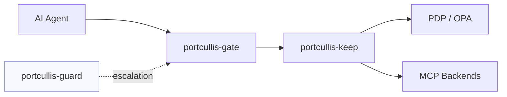

# PortcullisMCP

Authorization gateway for AI agents using MCP. Every tool call is policy-checked. Sensitive actions require human approval. Everything is logged.

- **Policy-as-Code**: OPA (or any PDP) evaluates each MCP request and returns allow / deny / escalate
- **Human-in-the-Loop**: escalation tokens bind approval to exact arguments; an agent cannot reuse them for different calls
- **Complete audit trail**: identity, tool call, policy decision, and tool response — exportable to your SIEM
- **No credentials in the agent**: identity and secrets are injected by Portcullis
- **Fails closed**: if the PDP is unreachable, nothing runs

## Enterprise support

Portcullis is built and maintained by [PAC.Labs](https://paclabs.io), who provide production support (SLA-backed) and implementation services for Portcullis and OPA deployments in finance, healthcare, and government.

## Architecture



[Full component and data-flow documentation](./ARCHITECTURE.md)

## Quickstart

### Try without a Go toolchain (Docker only)

**Prerequisites:** Docker, `make`

```sh
git clone https://github.com/paclabsnet/PortcullisMCP.git
cd PortcullisMCP
make demo-start
```

The demo stack builds and starts entirely inside Docker — no local Go installation needed.

| Service | URL |
|---------|-----|
| Keep (MCP gateway) | http://localhost:8080 |
| Guard (approval UI) | http://localhost:8444 |
| OPA (policy engine) | http://localhost:8181 |
| Mock enterprise API | internal |
| Fetch MCP backend | internal |

The mock enterprise API includes tools with deliberately dangerous operations (order deletion, status updates) so the included sample policies have something realistic to escalate.

**Install Gate** so your MCP client can launch it. Download a pre-built binary for your platform from the [Releases page](https://github.com/paclabsnet/PortcullisMCP/releases) and place it in your `PATH`.

**Configure your MCP client.** Example for Claude Desktop (`claude_desktop_config.json`):

```json
"mcpServers": {
    "portcullis": {
        "command": "portcullis-gate",
        "args": ["-config", "~/.portcullis/gate.yaml"]
    }
}
```

Copy `config/gate-config.minimal-oidc-login.yaml` to `~/.portcullis/gate.yaml` and set `keep_url: http://localhost:8080`. Gate is launched automatically by the MCP client via stdio — do not start it manually.

> **Windows:** See [docs/quickstart-windows.md](docs/quickstart-windows.md) for a step-by-step walkthrough including PATH setup.

### Run the demo

With the stack running and Gate configured, try these prompts with your agent:

```
What services are available from Portcullis MCP?

Please use Portcullis to fetch the latest headlines from bbc.com

Please use Portcullis to query orders for customer C001

Please use Portcullis to update order O001 status to shipped
```

The last request triggers an escalation. The agent will present a link — click it, review the exact tool arguments on the Guard approval page at `http://localhost:8444`, and approve. Ask the agent to retry; it should succeed.

```sh
make demo-stop   # stop the demo stack
```

### Build from source (contributors)

**Prerequisites:** Go 1.24+, Docker, `make`

```sh
make build        # compile portcullis-gate, keep, guard into bin/
make install      # install portcullis-gate to GOPATH/bin
make demo-start   # start OPA + Keep + Guard + demo backends in Docker
go test ./...     # run all tests
```

For full system requirements, see [docs/system-requirements.md](docs/system-requirements.md).

## How it works

Three components form the system:

**portcullis-gate** — lives on the user's desktop (or runs as an HTTP server in multi-tenant mode). Launched by the MCP client via stdio. Attaches verified user identity to every request and handles local filesystem access via a fast-path that skips the network.

**portcullis-keep** — the central gateway proxy. Validates identity, calls the PDP for every tool request, and routes allowed calls to backend MCP servers. Hides all MCP instances behind a single interface.

**portcullis-guard** — the human-approval service. Presents a web UI showing the exact tool arguments the agent tried to use. Issues signed JWTs cryptographically bound to those arguments; the token cannot be reused for different arguments or a different tool.

For a detailed walkthrough of the escalation flow, see [ARCHITECTURE.md](./ARCHITECTURE.md).

## Documentation

| Topic | Link |
|-------|------|
| Architecture and component details | [ARCHITECTURE.md](./ARCHITECTURE.md) |
| Configuration reference (Gate / Keep / Guard) | [docs/configuration.md](docs/configuration.md) |
| Policy authoring and OPA examples | [docs/policy/opa-examples.md](docs/policy/opa-examples.md) |
| FAQ and common objections | [docs/faq.md](docs/faq.md) |
| Security guidance and Guard SSO proxy | [docs/guard-sso-proxy.md](docs/guard-sso-proxy.md) |
| Vault secret URI integration | [docs/vault-integration.md](docs/vault-integration.md) |
| System requirements | [docs/system-requirements.md](docs/system-requirements.md) |
| Single vs multi-tenant Gate | [docs/single-vs-multi-tenant-portcullis-gate.md](docs/single-vs-multi-tenant-portcullis-gate.md) |
| Roadmap | [docs/roadmap.md](docs/roadmap.md) |
| Windows quickstart | [docs/quickstart-windows.md](docs/quickstart-windows.md) |

## Contributing

See [CONTRIBUTING.md](CONTRIBUTING.md).

## Security

To report a vulnerability, see [SECURITY.md](SECURITY.md). For Guard deployment hardening (preventing agent self-approval), see [docs/guard-sso-proxy.md](docs/guard-sso-proxy.md).

## License

Apache License 2.0. See [LICENSE](LICENSE).
